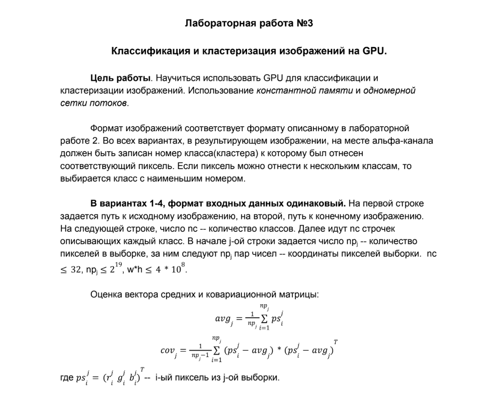
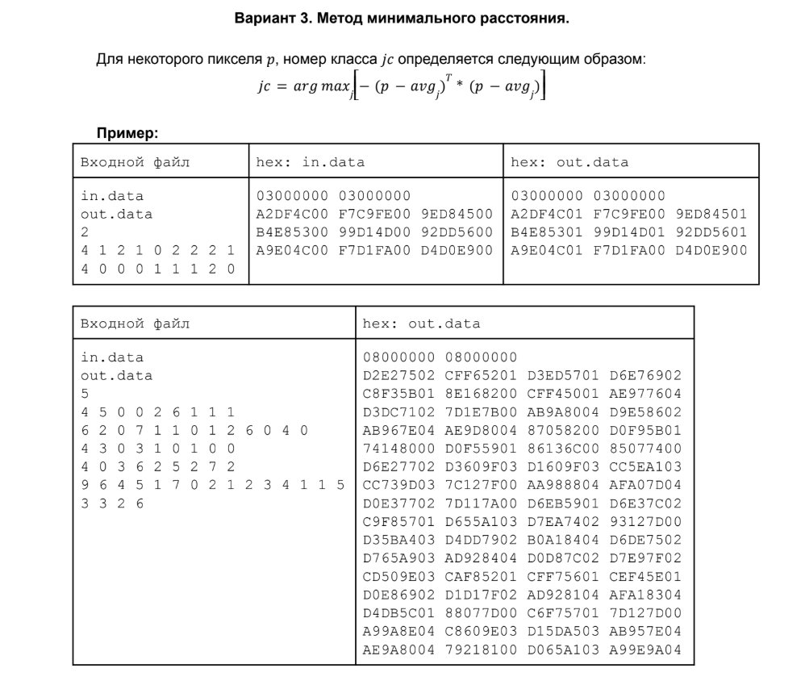

# Лабораторная работа №3





## Building the Programs

```bash
make all
```

This builds:

```text
build/lab3
build/benchmark
report/report.pdf
```

## Building the Report

```bash
make report
```

This creates:

```text
report/benchmark_results.txt
report/shrek/shrek_classes.png
report/report.pdf
```

## Running the Program

```bash
mkdir -p data/out
build/lab3
```

Enter:

```text
data/in/04.data
data/out/04.data
2
4 1 2 1 0 2 2 2 1
4 0 0 0 1 1 1 2 0
```

## Running the Benchmark

```bash
make benchmark
```

The results are saved to:

```text
report/benchmark_results.txt
```

## Cleaning

```bash
make clean
```

## Inspecting the Result Manually

```bash
xxd -g 4 -c 4 data/out/04.data
```

Expected output:

```text
00000000: 03000000  ....
00000004: 03000000  ....
00000008: a2df4c01  ..L.
0000000c: f7c9fe00  ....
00000010: 9ed84501  ..E.
00000014: b4e85301  ..S.
00000018: 99d14d01  ..M.
0000001c: 92dd5601  ..V.
00000020: a9e04c01  ..L.
00000024: f7d1fa00  ....
00000028: d4d0e900  ....
```
